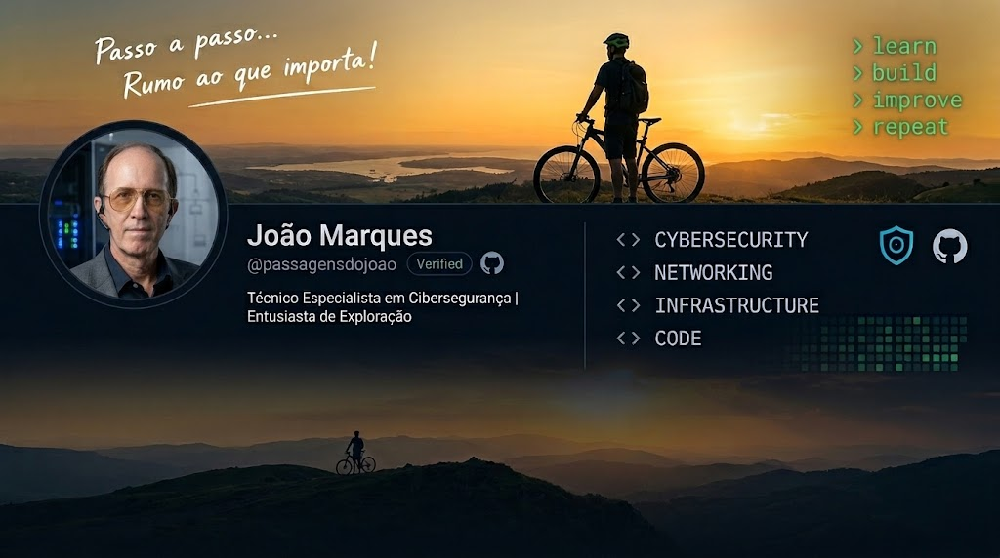

# 🔐 CyberLab Pro

### Cibersegurança • Laboratórios • Aprendizagem contínua
*Cybersecurity • Labs • Continuous Learning*

**Passo a passo. Rumo ao que importa.**  
*Step by step. Focused on what matters.*

A construir conhecimento através de experiências práticas,  
laboratórios, desafios e projetos documentados.

*Building knowledge through hands-on labs, challenges,  
and documented projects.*

💻 **Explorar.** 🔍 **Compreender.** 🛡️ **Proteger.**

*Explore. Understand. Protect.*

---

# 👋 Bem-vindo ao meu GitHub

### 🔐 Cibersegurança | Formação técnica | Aprendizagem contínua

Sou João Marques e encontro-me a frequentar o **CET de Técnico Especialista em Cibersegurança**, no IEFP. Este percurso representa uma nova etapa no meu desenvolvimento pessoal e profissional.

Estou a consolidar conhecimentos em redes, administração de sistemas, programação, bases de dados e segurança informática, com especial interesse na análise de vulnerabilidades, deteção de ameaças, análise de evidências e ciberdefesa.

O meu objetivo é transformar conhecimentos teóricos em competências práticas, documentando a evolução do meu trabalho através de exercícios, laboratórios e projetos.

---

## 🎓 Formação — CET Técnico Especialista em Cibersegurança

A formação abrange 26 Unidades de Competência, incluindo áreas como:

- **Programação e dados:** algoritmos, Python, scripts de cibersegurança, análise de logs, SQL e estatística.
- **Redes e sistemas:** infraestrutura de redes, serviços de rede, Windows Server e Linux.
- **Cibersegurança e ciberdefesa:** vulnerabilidades, análise de ameaças, recolha de logs, IDS e análise forense digital.
- **Competências profissionais:** trabalho em equipa, inglês técnico, segurança e saúde no trabalho e enquadramento legal.

A Formação em Contexto de Trabalho será uma etapa importante para aplicar e aprofundar estas competências num ambiente profissional.

## 🧪 CyberLab Pro — Laboratório pessoal

O **CyberLab Pro** é o meu laboratório pessoal de cibersegurança, em desenvolvimento paralelo com o CET.

O objetivo é experimentar, testar e documentar tecnologias e conceitos em ambientes controlados, evoluindo progressivamente através de projetos práticos.

Áreas de exploração:

- 🌐 Redes e conectividade — Cisco Packet Tracer.
- 🖥️ Administração de sistemas — Windows Server, GPO e Linux.
- 🐍 Programação Python e análise de logs.
- 🗄️ Bases de dados e SQL.
- 🛡️ Fundamentos de segurança e análise de vulnerabilidades.
- 🔎 Análise de ameaças e MITRE ATT&CK.
- 📡 Monitorização e análise de tráfego com ferramentas como Wireshark e Suricata.
- 🔬 Exploração de ferramentas de segurança em laboratórios autorizados.

## 💻 Projetos e trabalhos práticos

Esta secção irá reunir os trabalhos desenvolvidos durante o CET e os projetos pessoais de aprendizagem.

| Projeto | Área | Estado |
|---|---|---|
| Python — análise de logs | Programação / Blue Team | Em desenvolvimento |
| Typosquatting e semelhança de domínios | Python / Segurança | Em desenvolvimento |
| Windows Server e políticas GPO | Administração de sistemas | Laboratório prático |
| Redes e Cisco Packet Tracer | Redes / Infraestrutura | Em aprendizagem |
| SQL e bases de dados | Dados | Exercícios práticos |
| CyberLab Pro | Laboratório integrado | Em evolução |

*Os projetos serão ligados aos respetivos repositórios à medida que forem organizados e publicados.*

## 🛠️ Scripts e ferramentas

Pretendo construir uma coleção de scripts e pequenas ferramentas para automatizar tarefas, analisar informação e apoiar atividades de cibersegurança.

- Scripts Python para análise e tratamento de logs.
- Deteção de padrões e eventos potencialmente suspeitos.
- Análise de semelhança entre domínios.
- Automatização de tarefas em sistemas Linux e Windows.
- Ferramentas de apoio a laboratórios de redes e segurança.

Cada projeto será acompanhado, sempre que possível, por documentação, instruções de utilização e exemplos de teste.

## 🎯 Aprendizagem complementar — TryHackMe

Estou também a explorar o **TryHackMe**, uma plataforma de aprendizagem prática que permite desenvolver competências em redes, sistemas operativos e cibersegurança.

O objetivo é complementar a formação com desafios e laboratórios, registando aprendizagens e notas técnicas quando adequado e permitido pelas regras da plataforma.

## 📚 Tecnologias e áreas em aprendizagem

`Python` · `SQL` · `Linux` · `Windows Server` · `PowerShell` · `Networking` · `Wireshark` · `Suricata` · `MITRE ATT&CK`

*As tecnologias apresentadas refletem áreas de estudo e experimentação, com níveis de experiência diferentes.*

## 🌱 Em evolução contínua

Acredito na aprendizagem consistente, na curiosidade e na prática. Cada exercício, erro corrigido e projeto concluído é mais um passo na construção de competências.

**Tijolo a tijolo, projeto a projeto.**

## 🔗 Encontra-me também em

- **LinkedIn:** (https://www.linkedin.com/in/joaormarques)
- **TryHackMe:**  (https://tryhackme.com/p/jlgrmarques)
- **YouTube — Passagens do João:** [https://www.youtube.com/@passagensdojoao](https://www.youtube.com/@passagensdojoao)

---

*Este portefólio está em construção e será atualizado à medida que o meu percurso de formação e os projetos evoluírem.*

---

## ⚙️ Tech Stack & Learning

  
  
  
  

  
  
  

  
  

<i>Learning by doing • Documenting every step • Building practical skills</i>

